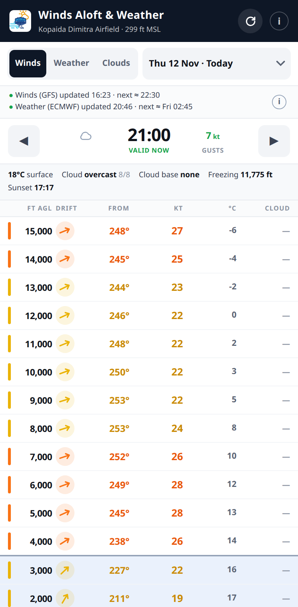
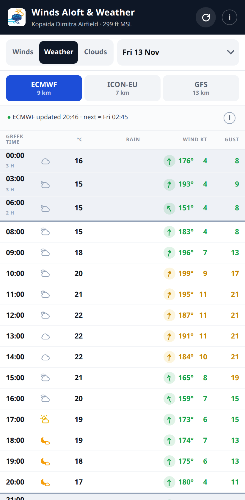
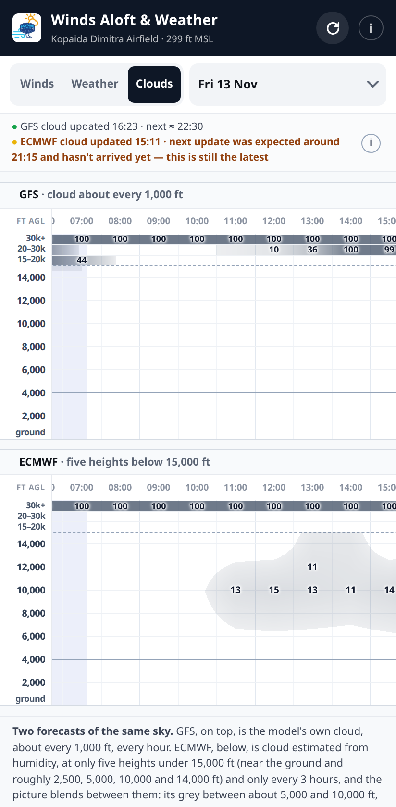
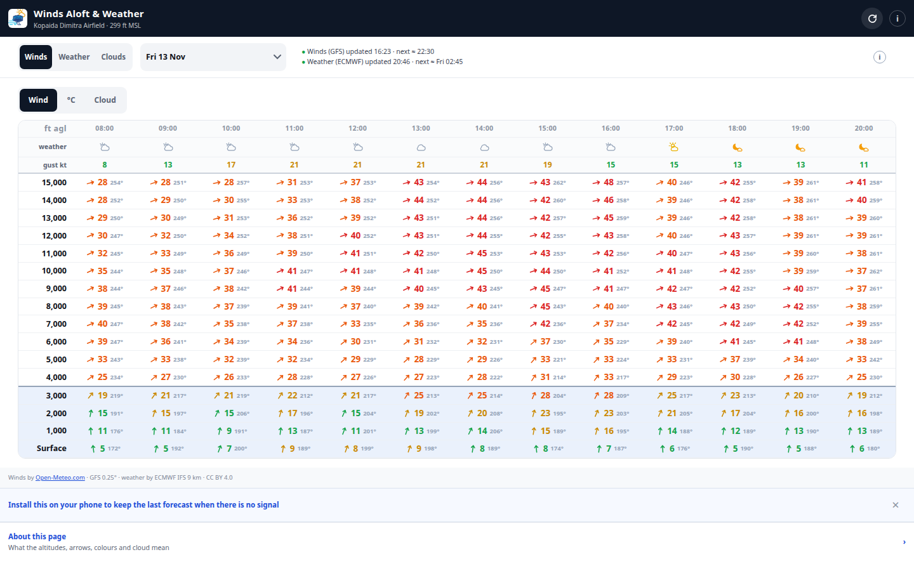
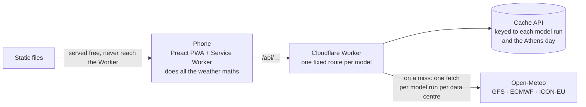

# Winds Aloft & Weather

**Winds aloft, surface weather and cloud by height for one drop zone: Kopaida Dimitra Airfield, Skydive Athens.**
A fast, installable progressive web app (PWA): <https://winds.skydive-athens.com> (and <https://weather.skydive-athens.com>, the same app
opening on its Weather screen).

| Winds | Weather | Clouds |
|---|---|---|
|  |  |  |

## Why I built it

I am a USPA-licensed skydiver and a certified skydiving coach, and I work at Skydive Athens as ground crew, so I saw
the problem from both the air and the ground. Every jumping day starts with the same questions: what the winds aloft
are doing and where the cloud is. The free winds-aloft tool we relied on was no longer maintained, and general weather
sites are heavy, partly paywalled and not built around one airfield, so jumpers pieced the answer together from several
of them. On my own initiative, I built a fast app locked on our drop zone that gives the winds every 1,000 ft above the
field, the way an altimeter reads, not above sea level.

## What it does

- **Winds every 1,000 ft** from the surface to 15,000 ft above the field, each with a drift arrow that points where the
  wind will carry you, its direction in degrees, its speed, temperature and cloud, coloured by severity.
- **Five days**, today and the next four, scrubbed hour by hour with no further network requests.
- **Surface weather from three models**, ECMWF, ICON-EU and GFS, side by side on a wide screen.
- **Cloud by height from two models**, GFS and ECMWF, painted through the day, with the cover printed every 2,000 ft.
- **An installable progressive web app (PWA)**: it installs to the home screen and works with no signal; the last
  forecast stays available and says plainly how old it is.
- **Greek local time everywhere**, correct across daylight-saving changes.

## Architecture

The Worker stays thin: it caches each forecast once per model run, checks a reply before keeping it, and streams it to
the phone, which builds the vertical profile and every number on screen. Everything runs on Cloudflare's free tier.

## Engineering highlights

- **Wind is blended as vectors, never as degrees.** Averaging 350° and 010° gives 180°, a wind from the opposite side of
  the sky. → [`sample/src/interpolate.ts`](sample/src/interpolate.ts)
- **Heights above the field, from the model's own geometry.** Each pressure level's height comes from its geopotential,
  minus the field's 299 ft. → [`sample/src/profile.ts`](sample/src/profile.ts), [ADR-0004](decisions/0004-agl-not-msl.md)
- **One pinned model per vertical profile.** Mixing models inside one column produced a sawtooth of several knots about
  every 750 ft. → [ADR-0003](decisions/0003-pin-gfs-never-best-match.md)
- **Cloud by height from two models, labelled for what they are**: GFS's own cloud, and ECMWF's as Open-Meteo estimates
  it from humidity, at fewer heights. → [`sample/src/cloud-view.ts`](sample/src/cloud-view.ts)
- **A thin Worker.** The Workers free plan allows 10 ms of CPU per request, so the Worker never computes the forecast;
  the phone does, from the raw profile, which also lets it scrub every hour for free. → [ADR-0005](decisions/0005-thin-worker.md)
- **An edge cache keyed to each forecast run**, so a new run replaces the old by existing, and **every reply is checked
  before it is cached**, so an empty or broken one is never served for hours. → [ADR-0006](decisions/0006-cache-api-and-why-workers-caching-is-off.md),
  [ADR-0025](decisions/0025-check-an-upstream-reply-before-caching-it.md)
- **True instants, not local time labels**, so the hours stay right across a daylight-saving change.
  → [ADR-0014](decisions/0014-real-instants-not-local-labels.md)
- **Offline, with the forecast's age shown**: a custom Workbox Service Worker keeps only forecasts that carry the
  server's freshness header, so an error page never becomes the offline copy. When the forecast service fails, it serves
  the last good copy and marks it, so the page keeps the forecast on screen and still says whether the phone has no
  signal or the service failed.

## How it is tested and shipped

- **Five layers of automated tests**: unit tests of the weather maths; integration tests inside the Workers runtime against
  a stubbed upstream; contract tests against the live Open-Meteo API, on a schedule; Playwright end-to-end tests on an
  emulated phone and a wide screen; and smoke checks against production after every deploy, which wait until the new
  build is the one being served.
- **CI/CD on GitHub Actions**: every push to main is type-checked and passes the unit, integration and end-to-end tests
  before it deploys; the contract tests also run daily and never block a deploy.
- **Within the free tier**: about 100 weighted Open-Meteo calls a day per Cloudflare data centre (measured 12 November
  2026), because each forecast is fetched once per model run, not once per visitor.
- **Written down**: a maintained specification, architecture decision records, a runbook, and a book that teaches the
  whole stack.

## Stack

TypeScript · Preact · Vite · Hono on Cloudflare Workers · Cache API · PWA (vite-plugin-pwa, Workbox) · Vitest · Playwright · GitHub Actions ·
Open-Meteo

## About this repository

Built pro bono for Skydive Athens. The app's source is private; this repository holds a runnable excerpt of its weather
core ([`sample/`](sample/)) and selected design records ([`decisions/`](decisions/)).

- **Code** in `sample/` is licensed under the PolyForm Noncommercial License 1.0.0.
- **Everything else** here, the documentation, screenshots and diagram, is licensed under CC BY-NC-ND 4.0.
- **Weather data** by [Open-Meteo.com](https://open-meteo.com), CC BY 4.0.

See [`LICENSE`](LICENSE).
